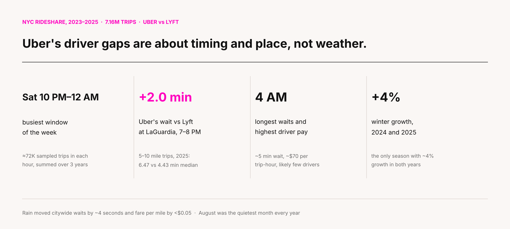
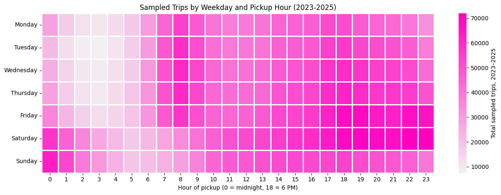
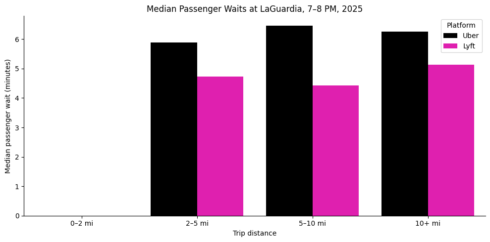
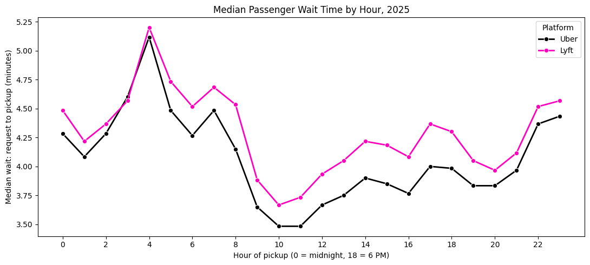
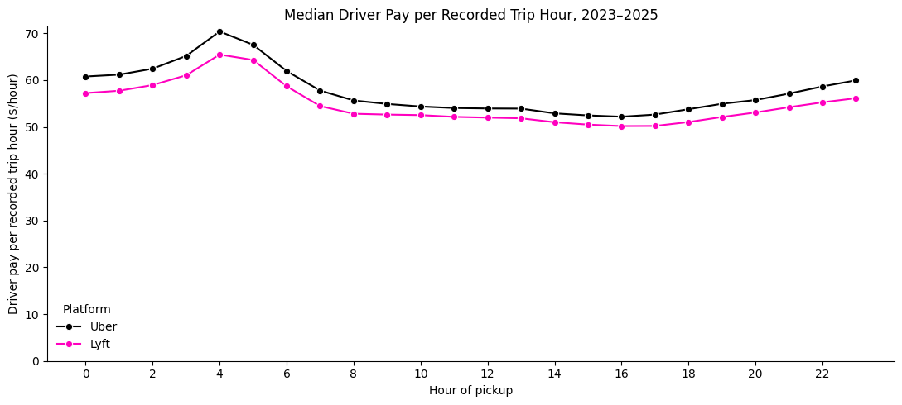
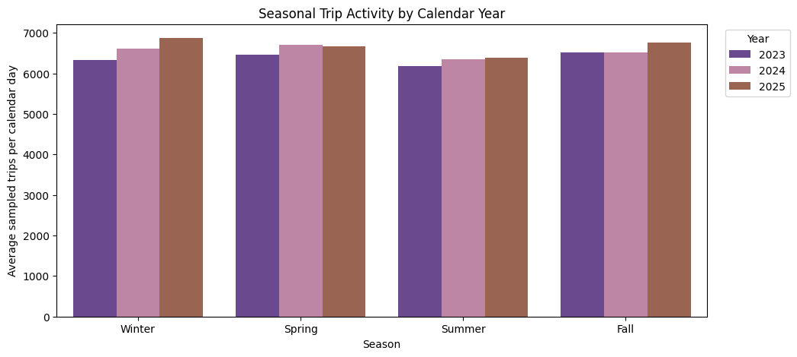

# When and where does NYC need more Uber drivers?

A three-year look at 7.16 million Uber and Lyft trips in New York City, joined with taxi-zone and daily weather data, to find out where Uber's driver supply falls short.

Group project for BA780 · I was the project manager · Python, pandas, seaborn · [Open the notebook in Colab](https://colab.research.google.com/github/melisgurbuz8/Technical-Projects-/blob/main/B06_NYC_Rideshare_Seasonal_Demand_Patterns_.ipynb)

## Executive summary

Uber completes far more NYC trips than Lyft (5.2M vs 1.9M in our sample), but scale does not guarantee shorter waits. When we compared the two platforms under the same conditions (same zone, same hour, same trip distance), Uber was sometimes the slower one. The clearest example is LaGuardia between 7 and 8 PM, where Uber riders on 5–10 mile trips waited about two minutes longer than Lyft riders.

Uber's shortfalls are tied to **specific hours and specific places**. Demand peaks on Friday and Saturday nights. The two airports are both the busiest zones and the slowest pickups. At 4 AM, passenger waits peak at the same hour that drivers earn the most per hour of driving, which suggests drivers are scarce then. Weather, which we expected to matter a lot, barely changed citywide waits or fares.

**What we'd tell Uber:** focus driver incentives on weekend nights, early mornings and airport pickups, plan for winter growth and a quiet August, and stop treating "it's raining" as a citywide signal.

---

## The question

Rideshare companies pay drivers to be in the right place at the right time. Get it wrong and riders wait, then open the competitor's app. We wanted to know when and where demand is highest, where riders wait longest, and whether season or weather changes the answer. We framed it from Uber's side, with Lyft as the benchmark.

We wrote down a hypothesis before each of our 15 questions and then checked it against the data. Ten held up, at least partly. Five didn't, and those taught us as much as the ten that did.

## The data

| Source | What we used |
|---|---|
| [NYC TLC trip records](https://www.nyc.gov/site/tlc/about/tlc-trip-record-data.page) | A 1% random sample of every monthly High-Volume For-Hire file, Jan 2023 – Dec 2025 (36 files, 7,155,498 trips) |
| [TLC taxi-zone lookup](https://d37ci6vzurychx.cloudfront.net/misc/taxi_zone_lookup.csv) | Turns pickup IDs into neighborhood and borough names |
| [NOAA climate data](https://www.ncei.noaa.gov/products/land-based-station/local-climatological-data) | Daily precipitation, temperature and wind at LaGuardia, used to label each day as dry or wet |

---

## What we found

### 1. The city is busiest on Saturday nights

The darkest cells sit in the bottom-right corner of the heatmap. Saturday from 10 PM to midnight was the busiest stretch of the week, with roughly 72,000 sampled trips in each of those hours across the three years. Weekday mornings around 8 AM also show up as a smaller commuter peak.

### 2. The airports are both the busiest and the slowest

LaGuardia (140,733 trips) and JFK (127,382) were the top two pickup zones, well ahead of East Village in third place. They also had the longest median waits of any busy zone, between 5.2 and 5.8 minutes. In most other zones, being busy did *not* mean riders waited longer. Uber out-tripped Lyft in every one of the top ten zones.

### 3. At LaGuardia during the evening rush, Lyft was faster

This is the comparison we found most useful. We held the location (LaGuardia), the hour (7–8 PM) and the year (2025) fixed, and then split trips by distance. We expected Lyft to be slower, but Uber was slower in every distance group. The biggest gap was for 5–10 mile trips: **6.47 minutes for Uber vs 4.43 for Lyft.** This result applies only to that place and hour, but it shows exactly where Uber should look at pickup coordination.

### 4. 4 AM is when riders wait longest and drivers earn the most

  
  

These two charts tell the same story from opposite sides. On the left, median waits on both platforms peak around 4 AM at about five minutes. On the right, median driver pay per trip-hour also peaks at 4 AM, at around $70 for Uber. Long waits and high pay at the same hour suggest there aren't enough drivers on the road. Pay is only measured while a passenger is in the car, so this is a lead to test, not proof.

### 5. Winter keeps growing and August is always quiet

We compared seasons using average trips per day, because seasons have different lengths and 2024 was a leap year. Winter was the only season that grew strongly in both years (+4.35% in 2024, +4.08% in 2025). Summer grew only slightly, and spring and fall each grew in one year and stayed flat or dipped in the other. August had the lowest daily average in all three years.

### 6. Weather mattered much less than we expected

Across the whole city, waits on rainy days were about four seconds longer than on dry days (4.07 vs 4.00 minutes). Fare per mile rose by under five cents. The effect depended on the zone: East Village got noticeably busier on wet days, while LaGuardia got slightly quieter. Weather is worth studying, but only at the level of individual zones and hours.

---

## What didn't hold up

We expected **winter to be the season with the longest waits**. It wasn't. The gap between the fastest and slowest season was about 15 seconds, and the slowest season changed from year to year.

We expected **the Uber–Lyft wait gap to be widest in winter**. The widest gap was actually in fall 2024 (Lyft 4.90 min vs Uber 3.77 min).

We expected **winter waits to peak in most of the busiest zones**. That was true only at the airports. Other zones peaked in different seasons.

We expected **Lyft to be slower at LaGuardia during the evening rush**. It was the opposite.

---

## How we handled messy data

Raw TLC data has problems, and we wanted to fix them without throwing away trips.

- **We checked each measurement separately instead of deleting whole rows.** A trip with a broken timestamp still counts toward demand but is left out of wait-time averages. This let us keep 7,155,498 of 7,155,499 rows (we removed one exact duplicate).
- **We found daylight-saving errors.** About 570 trips had durations that were off by exactly one hour, and every one of them fell in March or November.
- **We flagged impossible timestamps** (74,328 pickups recorded before the request) and treated them as missing instead of deleting the trips.
- **We found a change in how TLC reported one field.** The Access-A-Ride field was about 72% empty for most of 2023 and then suddenly complete. The gaps came from a reporting change, not random missing data.
- **We compared platforms like for like.** Every Uber vs Lyft comparison used the same zone, hour and distance, with at least 30 trips per group.

## Limitations, and what we'd do next

We only see completed trips. A rider who gave up and closed the app doesn't appear in the data, so we can't measure true unmet demand. Our weather data is one daily reading from LaGuardia, which averages out a 30-minute rush-hour downpour and stands in for all five boroughs. Our next steps would be hourly weather by zone, an estimate of how much of each fare Uber keeps after paying the driver, and adding more competitors.

## Recommendations

1. Add driver supply on Friday and Saturday evenings, starting with 10 PM to midnight on Saturdays.
2. Review pickup flow at LaGuardia during 7–8 PM, where Lyft was about two minutes faster.
3. Test small, targeted incentives around 4 AM and measure whether waits come down.
4. Plan winter growth and the August slowdown separately when setting onboarding and incentive budgets.
5. Use hourly, zone-level weather data before letting rain affect surge pricing.

---

## Running the notebook

Open it in [Colab](https://colab.research.google.com/github/melisgurbuz8/Technical-Projects-/blob/main/B06_NYC_Rideshare_Seasonal_Demand_Patterns_.ipynb). Add the [sampled dataset folder](https://drive.google.com/drive/folders/1B5RgYFus_WsXbsMI-O2wQXM4dcIUIt3_?usp=drive_link) to your Google Drive, point the `folder` variable at it, and run all cells. Weather data loads directly from NOAA. The [sampling notebook](https://colab.research.google.com/drive/1wv3SVu2i7ntKiKCfwRmoRl3HJwgceg7m?usp=drive_link) shows how the 1% samples were drawn. Charts for all 15 questions are in [`images/`](images/).

## Team

Elizabeth Lukina, Sally Hao, Taaseen Islam, Teddy Tessel and Melis Gurbuz. BA780, Group 6.

**My part:** As project manager I set the scope and timeline and kept 15 questions moving across five people. I also built the sampling loop that turned 36 months of raw TLC files into the 7.16M-row dataset everyone worked from.
<!-- Melis: add one or two specific things you owned here, e.g. a question you analyzed or the final presentation. -->

*AI tools were used for debugging and editing; details are in the notebook's disclosure section.*
